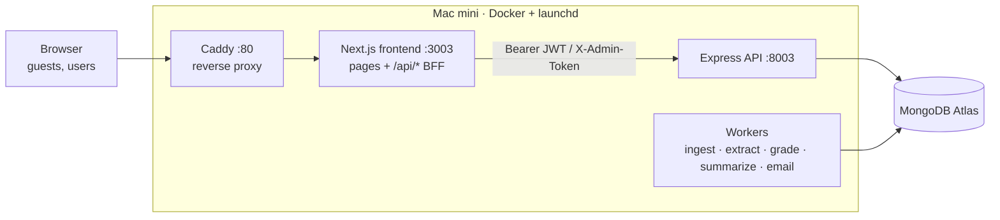
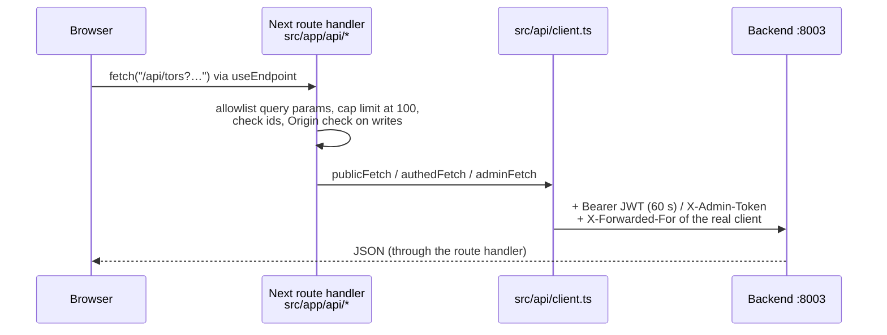

# Architecture

**The browser only talks to this Next.js app. Next.js calls the backend
server-side, and only the backend touches MongoDB.** No secret and no backend
URL ever reaches the browser.



Backend internals, all endpoints and the data model are in the
[backend docs](https://github.com/01219346-65-CSP-2026/BangkokTOR-backend/tree/main/docs).

## Tech stack

| Area | Choice | Notes |
|---|---|---|
| Framework | Next.js 16.3 App Router, `output: "standalone"`, React 19, TypeScript strict | Path alias `@/*` → `src/*` |
| Styling | Tailwind CSS v4, in-house UI kit in `src/components/ui/` | Design tokens in `src/app/globals.css`; rules in `CLAUDE.md` |
| Charts | recharts | |
| Auth | Auth.js / next-auth v5 with Google, JWT session in an encrypted cookie | `src/lib/auth.ts` |
| State | React state plus two contexts (language, notifications) | No Redux, SWR or React Query; `AGENTS.md` says add no dependencies |
| i18n | Hand-written, Thai by default | `src/i18n/` |
| Tooling | bun (packages, tests), ESLint 9 | |

## How a request flows (the BFF)



- **In the browser**, data loads through one hook, `src/api/useEndpoint.ts`:
  fetch on mount, abort on unmount, ignore stale responses, map with `select`.
  There is no polling.
- **Route handlers** (`src/app/api/**/route.ts`) never forward a query string
  as-is. They rebuild it from an allowlist, cap `limit` at 100, and check ids
  against `/^[a-f0-9]{24}$/`.
- **Every write** (POST/PUT/PATCH/DELETE) calls `rejectCrossOrigin()`
  (`src/lib/sameOrigin.ts`) first, which returns 403 unless `Origin` matches
  the app. This guards against CSRF from sibling `*.trueddns.com` sites. Do the
  same in any new write route.
- **`src/api/client.ts`** is server-only and is the only door to the backend:

| Transport | Sends | Used for |
|---|---|---|
| `publicFetch` | nothing | Public TOR and budget reads |
| `publicRaw` | nothing; streams bytes | PDF files |
| `authedFetch` | `Authorization: Bearer <HS256 JWT>`, signed with `INTERNAL_JWT_SECRET`, 60 s, `sub` = Google id | `/api/me/*`, advisory |
| `adminFetch` | the JWT + `X-Admin-Token` | Pipeline controls, capture import |
| `syncBackendUser` | `X-Admin-Token` only | `POST /api/user/sync` at sign-in |
| `meFetch` | the JWT | `GET /api/me` session re-check (below) |

Every transport forwards the caller's `X-Forwarded-For`, so the backend
rate-limits per real client instead of per frontend server.

## Sign-in and roles

1. **Sign-in:** `/login` → Google (`prompt=consent`). Sign-in is refused if
   Google says `email_verified=false`.
2. **On sign-in:** the `jwt` callback calls `POST /api/user/sync` and stores
   `userId`, `role` and `sessionVersion` in the token. If the backend is down,
   sign-in still succeeds and the next sign-in retries.
3. **On every later request:** the `jwt` callback calls `GET /api/me`. If
   `session_version` changed (a newer sign-in or a revocation) or the call
   fails, it returns `null` and the user is signed out (**fails closed**).
   Otherwise it refreshes `role`, so a demotion takes effect on the next
   request.
4. **Session lifetime:** 12 hours at most (`maxAge`).
5. **Guards:** `src/proxy.ts` (Next 16's name for middleware) protects
   `/dashboard`, `/skills`, `/profile`, `/admin`. A signed-out user goes to
   `/login?callbackUrl=…`; a non-admin on `/admin` goes to `/`. Route handlers
   check again: 401 if signed out, 403 if not admin.
6. **Roles:** `admin`, `client` (default), `agency`.
7. **Dev bypass:** `NEXT_PUBLIC_AUTH_BYPASS=true` adds a "bypass" sign-in. The
   module throws if it's on in a production build.

> **Watch out:** step 3 needs the backend's `GET /api/me`, which is still in
> backend PR #27. Without it, every signed-in user is signed out on their next
> request.

## Pages

| Route | What it does | Sign-in | FR |
|---|---|---|---|
| `/` | Landing page with live TORs | — | |
| `/tor` | TOR listing: filters, sort, paging and open/upcoming/closed tabs, all done by the backend | — | FR-12, 13 |
| `/tor/[id]` | Detail: 3-card summary, documents, signals, similar TORs; advisory when signed in | — | FR-14, 20 |
| `/dashboard` | Recommended TORs, insight charts, budget map | ✓ | FR-20 |
| `/skills` | 4-step skill-profile wizard with autosave and a live preview | ✓ | FR-15 |
| `/profile` | Google identity, skills, bookmarks scored by fit | ✓ | FR-15 |
| `/notifications` | Match notifications (shows its own sign-in prompt) | — | FR-16 |
| `/login`, `/signup` | Google sign-in only. Signup then goes to `/skills` | — | FR-01 |
| `/admin/sources` | Source management. **Mock data, no API yet** | admin | FR-07, 21 |
| `/admin/pipeline` | Workers, queues, errors, stop/flush/retry, e-GP CSV import | admin | FR-06 |

Error pages: `src/app/error.tsx`, `src/app/(public)/error.tsx`,
`src/app/not-found.tsx` (FR-22, 23).

## Code layout

```
src/app/(public)/      pages inside the NavBar shell
src/app/login, signup  auth screens
src/app/admin/         admin shell, sources/, pipeline/
src/app/api/           BFF route handlers (one folder per backend area)
src/api/               client.ts (server only), useEndpoint.ts, response mappers
src/components/        ui/ (kit), tor/, dashboard/, nav/, profile/, skills/, admin/, …
src/lib/               auth.ts, sameOrigin.ts, torFilters, torFit, recommend, budget, geo, deadline, …
src/i18n/              LanguageProvider + Translations (Thai default)
src/proxy.ts           route guard
checklist/             per-branch wiring tests
```

Next: [setup.md](setup.md)
